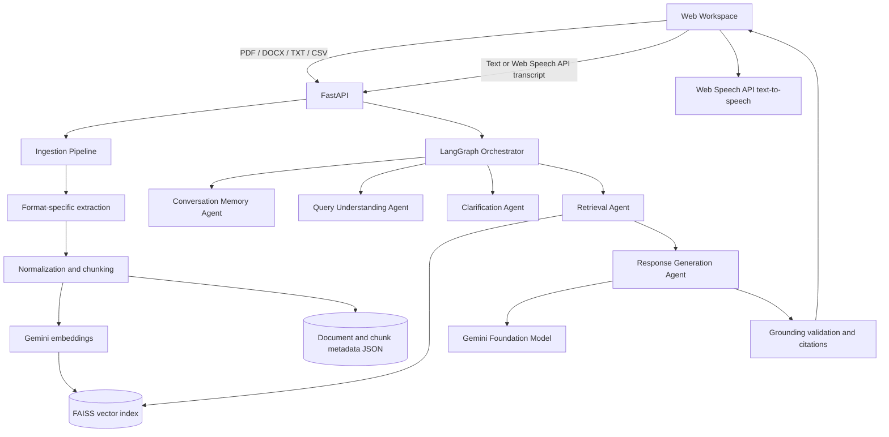

# AI-Based Knowledge Retrieval Platform with Query Resolution System

Milestone 1 implementation: a document-grounded RAG platform with five named agent responsibilities, persistent conversation memory, clarification handling, browser speech input/output, and an offline retrieval-evaluation harness.

## Milestone 1 scope

- **M1.1 Research and technical understanding:** RAG, embeddings, chunking, vector search, multi-agent roles/orchestration, and Web Speech API design are documented in `docs/M1_RESEARCH_AND_TECHNICAL_DESIGN.md`.
- **M1.2 System architecture:** component architecture, agent responsibilities, orchestration flow, data flow, and schemas are documented in `docs/SYSTEM_ARCHITECTURE.md`.
- **M1.3 Knowledge-base ingestion:** PDF, DOCX, TXT, and CSV upload, extraction, normalization, chunking, Gemini embedding generation, FAISS indexing, document metadata and chunk persistence.
- **M1.4 RAG retrieval and validation:** semantic retrieval, reranking, context filtering, grounded generation, citations, and Top-1/Top-3/Top-5 evaluation across HR and IT Support sample domains.

The repository intentionally excludes unrelated landing pages, portfolio animation, general-purpose UI component libraries, deployment infrastructure, streaming/SSE, and mock service adapters. The frontend is limited to the knowledge-base workspace and Web Speech API controls.

## Architecture overview



See the detailed architecture and flow in `docs/SYSTEM_ARCHITECTURE.md`.

## Technology stack

| Layer | Technology |
|---|---|
| Frontend | Next.js, React, TypeScript, CSS |
| Voice | Browser Web Speech API (`SpeechRecognition` / `webkitSpeechRecognition`, `speechSynthesis`) |
| Backend | Python, FastAPI, Pydantic |
| Agent orchestration | LangGraph |
| Foundation model | Google Gemini via `google-genai` |
| Embeddings | Gemini Embedding API (`RETRIEVAL_DOCUMENT`, `RETRIEVAL_QUERY`) |
| Vector search | FAISS inner-product index over normalized vectors (cosine similarity) |
| Metadata and chunks | JSON file-backed document store |
| Conversation memory | SQLite |
| Document extraction | PyMuPDF, python-docx, Python standard-library CSV parser |
| Testing | Pytest, FastAPI TestClient |

## Run locally

### 1. Backend

Python 3.12 or later is required.

```bash
cd backend
python -m venv .venv
# Windows PowerShell: .venv\Scripts\Activate.ps1
# macOS/Linux: source .venv/bin/activate
pip install -r requirements.txt
copy .env.example .env  # Windows
# cp .env.example .env  # macOS/Linux
```

Add a valid `GEMINI_API_KEY` to `backend/.env`, then run:

```bash
uvicorn app.main:app --reload --port 8000
```

API docs: <http://localhost:8000/docs>

### 2. Frontend

```bash
cd frontend
npm install
npm run dev
```

Open <http://localhost:3000>. Browser speech recognition support varies by browser; use a current Chrome- or Edge-based browser for best support. Text input and output remain available without speech APIs.

## Main API endpoints

All endpoints use `/api/v1`.

| Method | Endpoint | Purpose |
|---|---|---|
| POST | `/documents/upload` | Upload one PDF, DOCX, TXT, or CSV file (`multipart/form-data`, field `file`) |
| GET | `/documents` | List indexed documents and chunk counts |
| DELETE | `/documents/{document_id}` | Remove document metadata, chunks, and vector entries |
| POST | `/query` | Run multi-agent RAG query resolution |

Example query request:

```json
{
  "question": "How many days of paid annual leave are provided?",
  "conversation_id": "optional-session-id"
}
```

The first request may omit `conversation_id`; the API returns one. Send that value on follow-up requests to reuse conversation context. A request scoped to selected documents can include `document_ids`.

## Retrieval evaluation (M1.4)

Two sample knowledge bases and an evaluation set are included under `backend/evaluation/datasets/`:

- Synthetic HR policy domain
- Synthetic IT Support domain
- Factual, procedural, comparative, and unavailable-information query types

Run from `backend/`:

```bash
python scripts/evaluate_retrieval.py
```

This script requires `GEMINI_API_KEY` because the query and document embeddings are generated by Gemini. It builds a separate evaluation-only index under `backend/data/evaluation/`, leaving documents uploaded through the application untouched, and writes `evaluation/results/retrieval_evaluation.json`.

Top-K accuracy is measured as chunk-level Hit@K: the fraction of answerable evaluation queries for which at least one labelled evidence chunk appears in the first K reranked results. Each answerable query labels one or more exact evidence phrases, which the runner maps to chunk IDs. Unanswerable queries are reported separately and are not counted in the retrieval hit-rate denominator. The report includes overall and per-domain Top-1/3/5 metrics, ranked chunk IDs, scores, and low-relevance results. The included HR and IT files are synthetic evaluation data, not real organizational policies.

## Tests

Run from `backend/`:

```bash
pytest
```

Tests mock Gemini calls and use isolated temporary metadata/index storage. The retrieval metric and agent component tests are deterministic. Live retrieval evaluation is a separate command because it uses the configured embedding provider.

## Repository structure

```text
.
├── backend/
│   ├── app/
│   │   ├── agents/          # Five milestone agent responsibilities
│   │   ├── api/             # Upload, document management and query APIs
│   │   ├── core/            # Settings, errors, logging and provider retry
│   │   ├── evaluation/      # Top-K retrieval metrics
│   │   ├── generation/      # Query refinement, grounded response, evidence checks
│   │   ├── graph/           # LangGraph state, nodes, edges and orchestration
│   │   ├── ingestion/       # PDF, DOCX, TXT, CSV, cleaning and chunking
│   │   ├── models/          # API and internal data schemas
│   │   ├── retrieval/       # Embeddings, FAISS, reranking and context filtering
│   │   └── storage/         # Document metadata, chunks and FAISS persistence
│   ├── evaluation/datasets/ # Two-domain sample knowledge base and labelled queries
│   ├── scripts/             # Retrieval evaluation runner
│   ├── tests/               # Unit, integration and workflow tests
│   ├── .env.example
│   └── requirements.txt
├── docs/                    # M1.1 research and M1.2 architecture documentation
└── frontend/                # Minimal knowledge-base and voice workspace
```

## Security and data handling

- Never commit `.env` or real provider credentials.
- Runtime documents, vectors, metadata and conversation history are generated under `backend/data/` and are ignored by Git.
- Uploaded originals are parsed in-memory; extracted chunk text and metadata are persisted for retrieval.
- Conversation history is stored by session ID in SQLite and limited by `CONVERSATION_HISTORY_LIMIT`.
