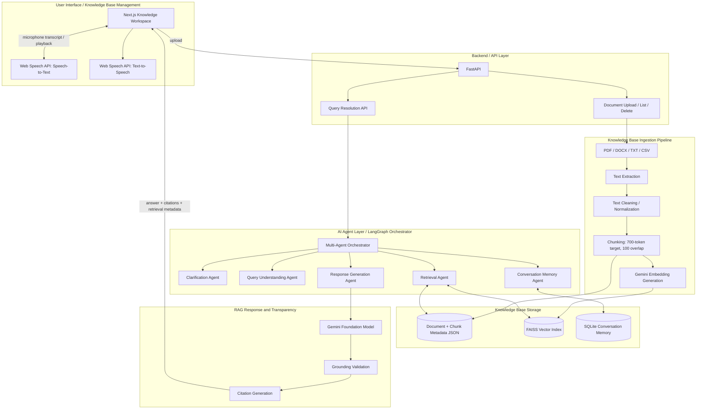
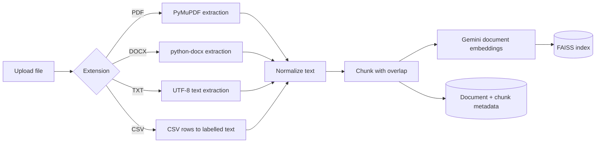
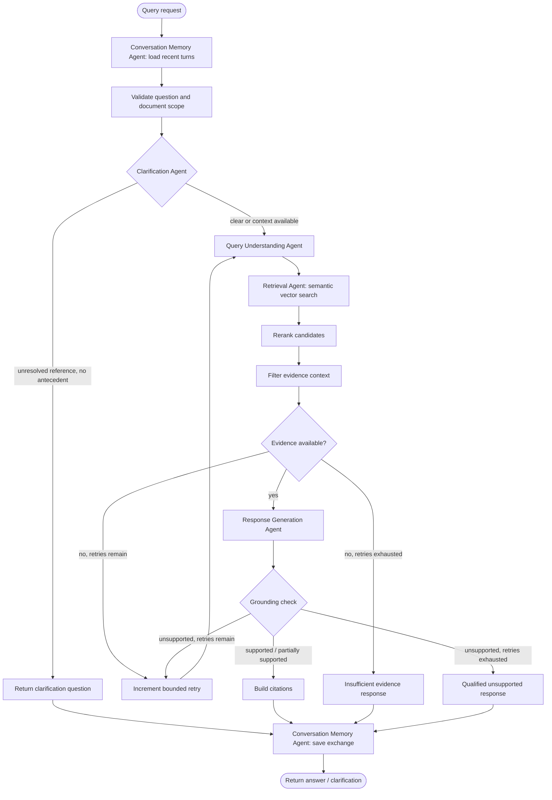

# M1.2 — System Architecture and Data Models

## 1. Component architecture



## 2. Document ingestion data flow



### Ingestion guarantees

- The upload API accepts only `.pdf`, `.docx`, `.txt`, and `.csv` files up to the configured maximum size.
- A parser extracts textual content and format-specific metadata.
- Normalization is applied before chunking.
- Every chunk receives a stable `chunk_id`, its `document_id`, filename, file type, optional page/section metadata, text, and chunk metadata.
- The embedding vector is stored in FAISS; the chunk text and metadata are persisted separately so retrieved vector IDs can be resolved to source text and citations.

## 3. Query resolution and orchestration flow



### Agent responsibilities and boundaries

1. **Query Understanding Agent** — preserves the original question, uses recent session history to resolve references, and optionally rewrites a query for retrieval. The original question remains the generation target.
2. **Retrieval Agent** — owns semantic candidate retrieval, reranking, and evidence-context selection. It does not generate the final natural-language answer.
3. **Response Generation Agent** — produces the answer from selected chunks only and invokes grounding validation.
4. **Clarification Agent** — runs before retrieval. For a short unresolved reference without session history, it returns a clarifying question instead of making an unsupported retrieval guess.
5. **Conversation Memory Agent** — loads and persists the most recent user/assistant messages for a `conversation_id`; the configured message limit bounds the context supplied to query understanding.
6. **Multi-Agent Orchestrator** — LangGraph connects these roles, handles branches and controls retry count.

## 4. Data model definitions

### Document

| Field | Type | Meaning |
|---|---|---|
| `document_id` | string | Unique ID for an uploaded document |
| `filename` | string | Sanitized original filename |
| `file_type` | string | `pdf`, `docx`, `txt`, or `csv` |
| `source_text` | string | Extracted document text before chunking |
| `metadata` | object | Format-specific extraction metadata |
| `sections` | array | Text sections with page/section provenance |

### Chunk

| Field | Type | Meaning |
|---|---|---|
| `chunk_id` | string | Unique chunk ID |
| `document_id` | string | Parent document ID |
| `filename` | string | Source filename |
| `file_type` | string | Source format |
| `page_number` | integer or null | Source page where available |
| `section` | string or null | Source heading, table row, or section |
| `text` | string | Chunk body used for embedding and generation |
| `metadata` | object | Estimated token count and source text length |

### Embedding record

| Field | Type | Meaning |
|---|---|---|
| `chunk_id` | string | Chunk referenced by the vector |
| `document_id` | string | Parent document for scoped retrieval |
| `vector` | float array | Gemini embedding; stored in FAISS rather than JSON |
| `dimension` | integer | Embedding vector size |

### Query request

```json
{
  "question": "How do I connect to the VPN?",
  "conversation_id": "optional-session-id",
  "document_ids": ["optional-document-id"]
}
```

`document_id` is accepted for single-document scope; clients must provide either `document_id` or `document_ids`, not both.

### Retrieval result

| Field | Type | Meaning |
|---|---|---|
| `chunk` | Chunk | Retrieved source chunk and provenance |
| `score` | float | Initial vector similarity score |
| `rerank_score` | float | Secondary similarity ranking score |

### Conversation message

| Field | Type | Meaning |
|---|---|---|
| `conversation_id` | string | Session identifier |
| `role` | string | `user` or `assistant` |
| `content` | string | Message text |
| `created_at` | ISO timestamp | Persistence time |

Messages are stored in SQLite and loaded in chronological order, bounded by `CONVERSATION_HISTORY_LIMIT`.

### Query response

| Field | Type | Meaning |
|---|---|---|
| `conversation_id` | string | Session ID to send on the next turn |
| `clarification_required` | boolean | Whether the answer is a clarification question |
| `answer` | string | Generated or clarification response |
| `citations` | array | Source document, chunk and excerpt references |
| `grounding_status` | string | Supported, partially supported, unsupported, insufficient context, or clarification required |
| `retrieval_metadata` | object | Candidate, reranked, selected counts and rewrite/retry details |

## 5. Persistence layout

Runtime data is generated under `backend/data/` and excluded from source control:

```text
data/
├── storage/
│   ├── documents.json
│   ├── chunks.json
│   └── conversations.sqlite3
└── index/
    ├── index.faiss
    └── meta.json
```

The JSON store retains document metadata and chunk text. FAISS retains vector data with a parallel ID metadata map. SQLite retains bounded conversation messages.
